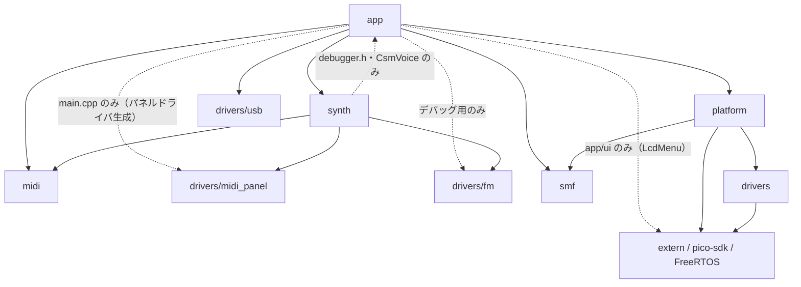
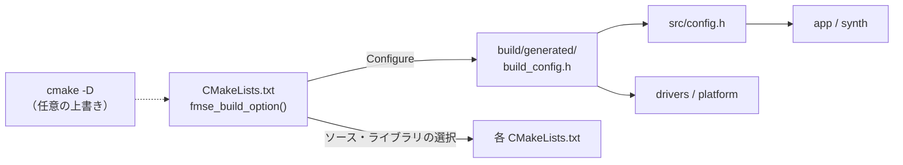

# アーキテクチャ設計仕様

プロジェクト全体の構成、各レイヤの役割、依存関係の制約を記述する。

## 目次

1. [アーキテクチャコンセプト](#1-アーキテクチャコンセプト)
2. [ハードウェア構成](#2-ハードウェア構成)
3. [ディレクトリ構成とレイヤの役割](#3-ディレクトリ構成とレイヤの役割)
4. [依存関係](#4-依存関係)
5. [タスク構成](#5-タスク構成)
6. [拡張ガイドライン](#6-拡張ガイドライン)
7. [Build-time Switch](#7-build-time-switch)

---

## 1. アーキテクチャコンセプト

| コンセプト | 説明 |
|-----------|------|
| レイヤ構造 | `app` が機能を統合し、`synth` / `midi` / `platform` に委譲する。`synth` は音源抽象、`midi` は MIDI 処理、`platform` はボード統合を担当する |
| ハードウェア抽象化 | `drivers` は再利用可能な低レベル部品、`platform` はこの基板での資源所有・初期化順・ピン/PIO 割り当てを担当する |
| 外部ライブラリ分離 | `extern/` に集約し、本体コードと分離する |
| FreeRTOS SMP | RP2350 / RP2040 デュアルコアを FreeRTOS SMP ポートで稼働。Core0 に I/O タスク群、Core1 に音源エンジンタスクを固定配置する |
| 並列性設計 | 詳細は [design_concurrency.md](design_concurrency.md) を参照 |

各ドメインの主要クラスと依存関係は [domain/README.md](domain/README.md) のドメインチャートを参照。

---

## 2. ハードウェア構成

ハードウェアの詳細は [spec_system.md](../hardware/spec_system.md) を参照。

```
  Raspberry Pi Pico (RP2350 or RP2040)

  PIO0 ─── FM Bus (8-bit data, addr, CS×4, RD/WR, IRQ)
               ├── Dock0: YM2608 / YM2203 / YMF288
               ├── Dock1: YM2608 / YM2203 / YMF288
               ├── Dock2: YM2608 / YM2203 / YMF288
               └── Dock3: YM2608 / YM2203 / YMF288

  PIO1 ─── 2-wire serial → NJU72343 (電子ボリューム)

  SPI  ─── SD カード (FatFs / no-OS-FatFS)

  USB  ─── USB MIDI Device (TinyUSB)
```

MIDI Panel は FM 音源 LSI の I/O PortA/B を使用する外付けパネルであり、接続先 Dock はシステム仕様として固定しない。`src/app/main.cpp` の `CreateMidiPanelDriver(modules[n])` で Dock を選択する（現行は Dock3）。`modules[n] == nullptr` のときは `NullMidiPanelDriver` が注入され、パネル機能は無効になる。詳細は [design_midi_panel.md](../midi_panel/design_midi_panel.md)。チップ制約は [spec_fm_chip.md](../hardware/spec_fm_chip.md)。

---

## 3. ディレクトリ構成とレイヤの役割

### ディレクトリ構成

```
FMSynthEnsembleV3/
├── src/
│   ├── config.h           ビルド時設定（全レイヤ共通。7章参照）
│   ├── app/               アプリケーションレイヤ
│   │   └── ui/            LcdMenu の画面定義・入力アダプタ (BUILD_I2C_DISPLAY=ON時)
│   ├── midi/              MIDI パース・ルーティングレイヤ
│   ├── smf/               SMFファイルフォーマット解釈・再生順序決定レイヤ (BUILD_SD_CARD=ON時)
│   ├── synth/             シンセサイザー抽象化レイヤ
│   ├── drivers/           デバイスドライバレイヤ
│   │   ├── fm/            FM音源ドライバ (YM2203, YM2608, YMF288, OpnBase, opn_piolib)
│   │   ├── midi_panel/    MIDI パネルドライバ (FM 経由 LED matrix + スイッチ)
│   │   ├── display/       キャラクタ LCD ドライバ (RW1063 互換、BUILD_I2C_DISPLAY=ON時)
│   │   ├── storage/       ストレージドライバ (FatFs)
│   │   └── usb/           USB MIDI ドライバ (TinyUSB)
│   └── platform/          ボード統合レイヤ
├── extern/                外部ライブラリ (git submodule)
│   ├── FreeRTOS-Kernel/
│   ├── NJU72343-library/
│   ├── no-OS-FatFS-SD-SDIO-SPI-RPi-Pico/
│   └── LcdMenu/
├── cmake/                 ビルド用 CMake 関数（構造オプションの宣言と build_config.h の生成を含む）
├── sbom/                  SBOM（CycloneDX。scripts/sbom/update.sh で生成）
├── scripts/               開発用スクリプト（SBOM 生成、submodule 復元）
├── tools/                 開発ツール（SMF 解析、FM レベル測定、音色テーブル生成）
├── tests/                 ホストユニットテスト（GoogleTest。ファームウェアとは独立した CMake プロジェクト）
└── doc/                   ドキュメント
```

### app/（アプリケーションレイヤ）

| ファイル | 役割 |
|---------|------|
| `main.cpp` | エントリポイント。初期化・電子ボリューム設定・FreeRTOS タスク生成・スケジューラ起動 |
| `task_config.h` | タスク優先度・スタックサイズ・Core Affinity マスク・`MIDI_PANEL_PERIOD_MS` の定数定義 |
| `midi_ipc.h/cpp` | MIDI 用 Core 間キューと統計カウンタ |
| `csm_ipc.h/cpp` | CSM フレーム処理用イベントキュー |
| `*_task.h/cpp` | 各 FreeRTOS タスクの実装 |
| `debugger.h/cpp` | デバッグ用モジュール、対話型デバッガの提供 |
| `ui/`（`BUILD_I2C_DISPLAY=ON`時） | LcdMenu の画面定義・入力アダプタ。詳細は [design_display_menu.md](../display/design_display_menu.md) |

**ルール**: ハードウェアを直接操作しない。`Platform::*` と `synth` の API のみ使用する。例外として、`ui/` は UI ロジックそのものである LcdMenu（`extern/LcdMenu`）を直接扱う。

---

### midi/（MIDI パース・ルーティングレイヤ）

MIDI バイト列の解釈と転送先決定を担うレイヤ。[Single Parse Rule](design_midi_pipeline.md#11-single-parse-rule) に従い、Core0 内でのみパースする。`synth/` レイヤの負荷軽減のため、扱わない MIDI メッセージをこのレイヤで破棄する。

| ファイル | 役割 |
|---------|------|
| `MidiMessage.h` | Core 間転送用の固定長構造体 (`MidiEvent`, `MidiControlEvent`, `MidiEventType`, `MidiControlType`) を定義 |
| `MidiParser.h/cpp` | MIDI バイト列を `MidiEvent` に変換 (`TryParseEvent`)。SysEx / Realtime の判定補助関数を提供 |
| `MidiController.h` | 対応 CC の番号と意味 (`MidiControllerAction`) を集約し、Channel Voice の転送可否を判定 |
| `MidiSysEx.h/cpp` | SysEx を Profile Reset / Vendor Debug / Drop に分類 |

**ルール**: `pico-sdk`・FreeRTOS・ドライバ層に依存しない。`MidiMessage.h` の型のみを依存関係として持ち、`app/` から利用される。

---

### smf/（SMFファイルフォーマット解釈・再生順序決定レイヤ）

SDカード上のStandard MIDI File（SMF）のチャンク・可変長数値（VLQ）・ランニングステータス・メタイベントを解釈し、連続再生の順序（範囲・リピート・シャッフル）を決めるレイヤ。`midi/` と同じく、SDカードの実I/Oには関与しない（実I/Oは `platform/` 側の `SmfSdByteSource` が担う）。

| ファイル | 役割 |
|---------|------|
| `SmfMessage.h` | パーサーが返すイベント型 (`SmfEvent`, `SmfEventKind`, `SmfTrackInfo`, `SmfScanResult`) を定義 |
| `SmfByteSource.h` | バイト列供給の抽象インターフェース |
| `SmfMemoryByteSource.h/cpp` | 固定バイト列をラップする実装（ホストユニットテスト・実機組み込みフィクスチャ用） |
| `SmfParser.h/cpp` | チャンクスキャン・複数トラックマージ・イベント解釈 |
| `PlaybackSequence.h/cpp` | 再生範囲の曲数・順序・カーソル・リピート・シャッフルを持ち、次/前の曲の位置を決める純粋ロジック（[design_smf_playback.md](../smf/design_smf_playback.md)） |

**ルール**: `pico-sdk`・FreeRTOS・ドライバ層に依存しない。詳細設計は [design_smf_player.md](../smf/design_smf_player.md) を参照。

---

### synth/（シンセサイザー抽象化レイヤ）

MIDI メッセージをハードウェア非依存な形で FM 音源に変換するレイヤ。

```
synth/
├── MidiFactory.h/cpp          MidiChannel と Voice の生成・接続
├── MidiPanelController.h/cpp  MIDI Panel ドライバ API の仲介（IMidiPanelDriver）
├── MidiProcessor.h/cpp        MIDI メッセージの受信・ディスパッチ
├── VoiceLimits.h              Voice 数の静的上限（最大 4 モジュール × 6ch + CSM 1）
├── channel/                   MIDI チャンネルの抽象化 (Note/Rhythm)
│   ├── MidiChannel            チャンネル基底クラス
│   ├── NoteChannel            Note チャンネル
│   └── RhythmChannel          Rhythm チャンネル
└── voice/                     Voice（発音単位）の抽象化
    ├── Voice                  Voice 基底クラス
    ├── VoiceAllocator         Voice の動的割り当て
    ├── IVoiceReclaimable.h    Voice 回収インターフェース
    ├── NoteVoice              FM Note Voice
    ├── CsmVoice               CSM（複合正弦波音声合成）Voice
    └── csm/VOICE.dat          CSM Voice データ
```

**ルール**: FM 音源デバイスへのアクセスは `drivers/fm` のインターフェース経由とする。

---

### drivers/（低レベルデバイスドライバレイヤ）

個別 IC・バス・周辺機能を操作する再利用可能な低レベル部品を格納する。ここでは「この基板でどのピンを使うか」「起動時にどの順序で初期化するか」「システム全体で誰が所有するか」は決めない。

**ルール**: `drivers` は `platform` に依存しない。ボード固有のピン割り当て、PIO/SM の選択、起動順序、共有資源の所有ポリシーは `platform` 側で決める。

#### drivers/midi_panel/

16 CH の LED・スイッチを持つ PanelSubsystem を制御するドライバ層。FM 音源モジュールの PortA/B に接続する。詳細は [design_midi_panel.md](../midi_panel/design_midi_panel.md)。

| ファイル | 役割 |
|---------|------|
| `IMidiPanelDriver.h` | 抽象インターフェース（LED ビットマップ・スイッチ・Tick・リセット） |
| `OpnMidiPanelDriver.h/cpp` | OPN PortA/B 経由のマトリックススキャン・トグル・LED 表示 |
| `NullMidiPanelDriver.h` | 未接続時用スタブ |
| `MidiPanelDriverFactory.h/cpp` | `CreateMidiPanelDriver(OpnBase*)` |

ハードウェア操作の責務はドライバに閉じ、`synth/MidiPanelController` は `IMidiPanelDriver` API のみ使用する。

#### drivers/fm/

| ファイル | 役割 |
|---------|------|
| `OpnBase.h/cpp` | YM2203/YM2608/YMF288 共通インターフェース（抽象基底クラス） |
| `YM2203.h/cpp` | YM2203 固有実装（FM 3ch + SSG） |
| `YM2608.h/cpp` | YM2608 固有実装（FM 6ch + Rhythm + SSG + LFO） |
| `YMF288.h/cpp` | YMF288 固有実装（FM 6ch + Rhythm + SSG + LFO、I/O ポートなし） |
| `tone/tone_table.inc` | FM パラメータテーブル（インクルードデータ） |
| `opn_piolib/` | PIO を使った FM 音源 LSI のバス操作ライブラリ |

`opn_piolib` は C API（`fm_bus_init`, `fm_device_init`, `write_reg`, `read_status`, `read_reg` 等）を提供し、PIO0 上の単一ステートマシン（`fm_bus`）で FM バスアクセスを実行するとともに、スピンロックにより CPU から見たトランザクション境界を保証する。仕様は [piolib_spec.md](../../src/drivers/fm/opn_piolib/doc/piolib_spec.md)。

#### drivers/display/

RW1063-0A 互換の I2C キャラクタ LCD（ACM2004D-FLW-FBW-IIC）を制御するドライバ層。I2C バスの所有・初期化は `platform` が行い、本層は渡されたバスハンドルで読み書きする。詳細は [spec_display_i2c.md](../display/spec_display_i2c.md)。

#### drivers/storage/

`hw_config.c` に SD カードの SPI ピン設定を記述する。no-OS-FatFS ライブラリが提供するコールバック構造体を実装する形式。

SD カードは SPI でのみ接続するので、no-OS-FatFS の SDIO ドライバ（`sd_driver/SDIO/*.c`）はビルドしない。SDIO ドライバは ZuluSCSI-firmware（GPL-3.0-or-later）由来で、使わないコードをファームに含めないためである（[ADR 0004](../ADR/0004-exclude-sdio-driver.md)）。`extern/CMakeLists.txt` で上流ターゲットのソース一覧から外し、共通部（`sd_card.c`）が参照する `sd_sdio_ctor()` と `rp2040_sdio_get_sd_status()` は `sdio_disabled.c` で定義する。どちらも SPI 接続のカードでは呼ばれない。

#### drivers/usb/

| ファイル | 役割 |
|---------|------|
| `tusb_config.h` | TinyUSB 設定（USB MIDI デバイスクラス有効化） |
| `usb_descriptors.cpp` | USB ディスクリプタ定義（VID/PID, string 等） |

TinyUSB の `tud_task()` 呼び出しと MIDI ストリーム読み出し (`tud_midi_n_stream_read`) はアプリケーション層の UsbMidiTask が担当し、このドライバ層は設定とディスクリプタのみを提供する。

---

### platform/（ボード統合レイヤ）

この基板で使うハードウェア資源の所有、初期化順、GPIO/PIO 割り当てを集約するレイヤ。必要に応じて `drivers` や `extern` の低レベル部品を利用し、上位レイヤ (`synth`, `app`) にはボード都合を隠した API を提供する。

`platform` は「低レベルドライバ」ではなく「ボード上の資源をどう組み合わせてシステムとして使うか」を決める場所である。例えば `VolumeController` は `extern/NJU72343-library` を使うが、PIO1/GPIO27/28 の選択、起動時ミュート、0dB 復帰という基板固有の所有ポリシーを持つため `platform` に配置する。

| ファイル | 役割 |
|---------|------|
| `init.h/cpp` | プラットフォーム初期化・FM モジュール検出の公開 API と `FmSystem` 定義。起動直後に `VolumeController` 経由で NJU72343 を全チャンネルミュートする。`BUILD_SD_CARD=ON`時はSDカードのマウント・再マウント（`RemountSdCard()`）も担う |
| `module_info.h` | Dock ごとのモジュール種類とリズムの有無（`ModuleInfo`）。`FmSystem` が保持し、app が FM ドライバに依存せずに構成を参照するために使う。`VolumeController` も `SetModuleInfo()` で同じ情報を受け取る |
| `volume_controller.h/cpp` | NJU72343 電子ボリューム制御のボード固有ラッパー。PIO1/GPIO27/28 の所有と音量 API を提供する |
| `isr.h/cpp` | GPIO 割り込みの登録・有効化 API（`FM_IRQ` 等） |
| `smf_sd_byte_source.h/cpp`（`BUILD_SD_CARD=ON`時） | `src/smf/` の `SmfByteSource` インターフェースをSDカードファイルで実装。FatFsの実アクセスはこのファイルに閉じる |
| `smf_directory.h/cpp`（`BUILD_SD_CARD=ON`時） | SDカード上の`.mid`/`.midi`/`.smf`ファイルを再帰的に列挙する（`ForEachSmfFile()`）。`playlist`フォルダ直下を名前昇順で列挙する（`ForEachPlaylistFile()`） |
| `display.h/cpp`（`BUILD_I2C_DISPLAY=ON`時） | I2C バスとキャラクタ LCD の所有・初期化。ステータス行用の書き込み API と、LcdMenu 向けの `CharacterDisplayInterface` を提供する |
| `lcd_character_display_adapter.h/cpp`（`BUILD_I2C_DISPLAY=ON`時） | LcdMenu の `CharacterDisplayInterface` を `drivers/display` で実装するアダプタ |
| `arduino_compat/`（`BUILD_I2C_DISPLAY=ON`時） | LcdMenu を pico-sdk 単体でビルドするための `Arduino.h` 互換シム |
| `freertos_hooks.cpp` | FreeRTOS フック（スタックオーバーフロー・ヒープ枯渇） |
| `FreeRTOSConfig.h` | FreeRTOS カーネルのコンパイル時設定 |

公開 API のクラス図は [domain_platform.md](domain/domain_platform.md) を参照。`VolumeController` の API 詳細と NJU72343 の制御方針は [design_volume_controller.md](../volume/design_volume_controller.md)、配線・レジスタ仕様は [spec_volume_controller.md](../volume/spec_volume_controller.md) を参照。

---

### extern/（外部ライブラリ）

git submodule はここで管理する。本体コードとの変更衝突を防ぐため **submodule の中身を直接編集しない**。設定はラッパー経由で行う。`extern/` 直下に置いた、submodule をこのプロジェクトに組み込むためのファイル（`CMakeLists.txt`、`submodules.lock`、`check_submodules.cmake`）はこの制約の対象外。

| ディレクトリ | ライブラリ | 用途 |
|------------|----------|------|
| `FreeRTOS-Kernel/` | FreeRTOS-Kernel | RTOS カーネル |
| `NJU72343-library/` | NJU72343-library | 電子ボリューム IC 制御 |
| `no-OS-FatFS-SD-SDIO-SPI-RPi-Pico/` | no-OS-FatFS | SD カード / FatFs |
| `LcdMenu/` | LcdMenu | キャラクタ LCD のメニュー UI フレームワーク（`app/ui` が使用） |

各 submodule が指すコミットは `extern/submodules.lock` にも記録する。git が持つ submodule のコミット ID は履歴の中にしかなく、`git init` し直すと失われるため、追跡対象のファイルに同じ情報を置いている。

| ファイル | 役割 |
|---------|------|
| `extern/submodules.lock` | submodule のパス・コミット ID・バージョンの目安。照合と復元の基準 |
| `extern/check_submodules.cmake` | Configure 時に各 submodule の HEAD を lock と照合し、未初期化・バージョン違い・lock への登録漏れなら止める |
| `scripts/restore-submodules.sh` | `.gitmodules` の URL と lock のコミットから submodule を登録し直す。`git init` し直したリポジトリ用（ZIP から始める場合を含む。手順は [build_ja.md](../build_ja.md#14-zip-アーカイブから始める場合)） |

`FREERTOS_KERNEL_PATH` で別の場所の FreeRTOS-Kernel を指定した場合、`extern/FreeRTOS-Kernel` は照合の対象外になり、Configure が警告を出す。このパスは CMake のキャッシュに残るため、以前の構成で作ったビルドディレクトリを使い回すと同じ警告が出る。その場合はビルドディレクトリを消して Configure し直す。

FreeRTOS-Kernel は pico-sdk にも Pico 拡張にも含まれないため、公式リポジトリを submodule として持ち、リリースタグのコミットに固定する（[ADR 0003](../ADR/0003-freertos-kernel-as-submodule.md)）。root `CMakeLists.txt` が `FREERTOS_KERNEL_PATH`（既定は `extern/FreeRTOS-Kernel`）を決め、`FreeRTOS_Kernel_import.cmake` がボードに合うポートを取り込む。RP2040 用ポートは FreeRTOS-Kernel 本体にある。RP2350 用ポートは FreeRTOS-Kernel 側の submodule（Community-Supported-Ports）にあるため、submodule は再帰的に初期化する。`PICO_PLATFORM=rp2350-arm-s` では **RP2350_ARM_NTZ** ポートが選択される。

`NJU72343-library` は汎用ドライバとして扱い、アプリケーション層から直接操作しない。ただし `LcdMenu` は UI ロジックそのものであるため、`app/ui` が直接扱う（[design_display_menu.md](../display/design_display_menu.md#6-レイヤ配置)）。基板固有のピン割り当て、PIO 選択、起動時ミュート、0dB 復帰、デバッグ用調整は `Platform::VolumeController` に集約する。

---

## 4. 依存関係

### CMake ライブラリ依存グラフ

```
FMSynthEnsembleV3 (実行ファイル)
  ├── synth
  │     ├── midi
  │     ├── fm
  │     ├── midi_panel
  │     │     └── fm
  │     └── platform
  ├── platform
  │     ├── pico_stdlib / hardware_gpio / hardware_irq / hardware_sync
  │     ├── tinyusb_device
  │     ├── nju72343
  │     ├── fm
  │     ├── display / lcdmenu (BUILD_I2C_DISPLAY=ON の場合のみ)
  │     ├── fatfs (BUILD_SD_CARD=ON の場合のみ)
  │     └── smf (BUILD_SD_CARD=ON の場合のみ)
  ├── drivers/fm
  │     └── opn_piolib
  ├── drivers/midi_panel
  │     └── fm (OpnBase)
  ├── drivers/usb
  │     ├── tinyusb_device
  │     ├── tinyusb_board
  │     └── pico_stdlib
  ├── drivers/display (BUILD_I2C_DISPLAY=ON の場合のみ)
  │     └── hardware_i2c
  ├── drivers/storage
  │     └── no-OS-FatFS-SD-SDIO-SPI-RPi-Pico
  ├── nju72343
  ├── FreeRTOS-Kernel         (extern/FreeRTOS-Kernel から提供)
  └── FreeRTOS-Kernel-Heap4   (extern/FreeRTOS-Kernel から提供)
```

### ソースコードの依存方向



依存方向の制約:

- `drivers` は `platform` に依存しない
- `platform` は `synth` / `app` に依存しない
- `midi` は `pico-sdk`・FreeRTOS・ドライバ層に依存しない
- `smf` は `pico-sdk`・FreeRTOS・ドライバ層に依存しない。SD カードの実 I/O は `platform` の実装に委ねる
- `synth` は純粋な MIDI イベント型・Controller Action 定義に限り `midi` に依存してよい。`midi` から `synth` への逆依存は禁止
- `synth` は必要な低レベル操作を `drivers` のインターフェース経由で行う。pico-sdk への直接依存は禁止。ログマクロ（`debugger.h`）に限り `app` を include してよい。ビルド時設定の `src/config.h` はどのレイヤからも include してよい（CMake 上も `synth` は `platform` をリンクするが、これは [design_csm_frame.md](../synth/design_csm_frame.md) の `CsmVoice` ISR 登録要件による）
- `app` はハードウェアを直接操作しない。FM モジュールの構成（種類・リズムの有無）は `Platform::ModuleInfo` で参照し、`drivers/fm` には依存しない。例外は次のとおり
  - デバッグ用（`MidiControlType::Debug*` の TL Trim トグルとデバッガコンソールでの状態表示）に限り、`drivers/fm` の static API を直接呼ぶ
  - `main.cpp` は全体を組み立てる場所として、`drivers/midi_panel` の `CreateMidiPanelDriver()` でパネルドライバを生成し、`synth` に渡す
  - `app/ui` は UI ロジックである `extern/LcdMenu` を直接扱う
  - pico-sdk は時刻（`pico/time.h`）と標準入出力（`pico/stdlib.h`）に限り使ってよい。GPIO・PIO などのハードウェア API は使わない
- `extern/` の submodule の中身は直接編集しない（upstream との乖離を防ぐ）
- GPIO ピン番号は `platform` レイヤ内に閉じ込め、上位レイヤでハードコードしない。共有ハードウェア資源のピン割り当ては、その資源を所有する `platform` 実装または公開が必要な `platform` ヘッダに集約する。例外: `drivers/storage/hw_config.c` は no-OS-FatFS が要求する静的コールバック構造体のため SPI/CS ピン番号を直書きする
- ビルド時の設定は、構造（外部ライブラリ・SDK の構成・特定ハードウェアに依存するコンポーネントの有無）を CMake、その上での調整を `src/config.h` に置く。基準と一覧は [7. Build-time Switch](#7-build-time-switch)

---

## 5. タスク構成

FreeRTOS SMP ポートで、Core0 に I/O 系タスク（USB MIDI 受信、MIDI パネル、SMF 再生、LCD メニュー、デバッガ）、Core1 に音源エンジン（`MidiEngineTask`、CSM 有効時は `CsmFrameTask`）を固定配置する。タスクの一覧・優先度の方針・Core 間通信・FreeRTOS の設定は [design_concurrency.md](design_concurrency.md) にまとめる。優先度・スタックサイズ・Core Affinity の具体値は `src/app/task_config.h` が唯一の定義元である。

---

## 6. 拡張ガイドライン

### 新しいドライバを追加する

1. `drivers/<カテゴリ>/` ディレクトリと `CMakeLists.txt` を作成する
2. `drivers/CMakeLists.txt` に `add_subdirectory(<カテゴリ>)` を追加する
3. 必要に応じて `platform/init.cpp` に初期化処理を追記し、`Platform::Initialize()` から呼ぶ
4. 上位レイヤへの公開 API は `Platform` 名前空間のヘッダに追加する。初期化全体に関わるものは `platform/init.h`、個別の共有ハードウェア資源は専用ヘッダ（例: `platform/volume_controller.h`）に分ける

### 静的ライブラリと SDK のリンク

各レイヤの静的ライブラリは、pico-sdk・FreeRTOS・TinyUSB・FatFs を通常どおり `target_link_libraries()` でリンクしてよい。これらは INTERFACE ライブラリで、リンク元にソースを追加する作りのため、そのままでは静的ライブラリごとに SDK 一式が重複コンパイルされる（フルビルド時間が約 3 倍になっていた）。

root `CMakeLists.txt` の末尾で呼ぶ `fmse_compile_only_interface_deps()`（`cmake/compile_only_interface_deps.cmake`）が、実行ファイルからたどれる静的ライブラリ（submodule の `nju72343` 等を含む）の INTERFACE ライブラリへのリンクを外す。外したライブラリからは、インクルードパス・コンパイル定義・コンパイルオプションだけを受け取る。外した INTERFACE ライブラリは実行ファイルにリンクし直すので、SDK 等のソースは実行ファイルのターゲットで 1 回だけコンパイルされる。生成される機械語は変わらない。

新しい静的ライブラリは、実行ファイルからリンクでたどれるようにしておけば自動的に対象になる。

### 外部ライブラリを追加する

```bash
# extern/ 以下に submodule として追加
git submodule add <URL> extern/<ライブラリ名>
```

`extern/CMakeLists.txt` に `add_subdirectory()` を追記する。ライブラリが pico-sdk 初期化後のインクルードを必要とする場合は root `CMakeLists.txt` に直接記述する。

追加した submodule のパスとコミット ID を `extern/submodules.lock` に 1 行追記する。lock に載っていない submodule があると Configure が失敗する。

```bash
git -C extern/<ライブラリ名> rev-parse HEAD   # lock に書くコミット ID
```

`scripts/sbom/catalog.py` にもコンポーネントとして登録し、`scripts/sbom/update.sh` で SBOM とライセンス表記を再生成する（[sbom.md](../process/sbom.md)）。catalog に未登録の submodule があると SBOM の生成が失敗する。

### 外部ライブラリのバージョンを変える

submodule 側で目的のバージョンを checkout し、`extern/submodules.lock` の該当行を同じコミットに書き換える。

```bash
git -C extern/<ライブラリ名> fetch --tags
git -C extern/<ライブラリ名> checkout <タグまたはコミット>
git -C extern/<ライブラリ名> submodule update --init --recursive
git -C extern/<ライブラリ名> rev-parse HEAD   # lock に書くコミット ID
```

3 行目は FreeRTOS-Kernel のように中に submodule を持つライブラリで必要になる。FreeRTOS-Kernel の RP2350 用ポートはここで新しいバージョンに切り替わる。

lock の 2 列目をコミット ID に、3 列目を新しいバージョンの表記に書き換える。3 列目は人が読むための目安で、照合には使われない。

Configure とビルドが通ることを確認してから、`scripts/sbom/update.sh` で SBOM とライセンス表記を再生成する（[sbom.md](../process/sbom.md)）。submodule・lock・`sbom/`・`THIRD_PARTY_NOTICES.md` を同じコミットに含める。submodule と lock の片方だけをコミットすると、他の環境や CI で Configure が失敗する。SBOM を更新し忘れると CI の SBOM 検査が失敗する。

```bash
scripts/sbom/update.sh
git add extern/<ライブラリ名> extern/submodules.lock sbom THIRD_PARTY_NOTICES.md
```

制約:

- `git submodule update --remote` は使わない。上流ブランチの先頭に進み、狙ったバージョンにならない
- FreeRTOS-Kernel は V11.2.0 以降にする。それより前のリリースは RP2350 用ポートを含まない
- FreeRTOS-Kernel を変えたときは `PICO_BOARD=pico2` と `PICO_BOARD=pico` の両方でビルドを確認する

### MIDI チャンネルの動作をカスタマイズする

- 新しい発音方式: `synth/voice/` に `Voice` を継承したクラスを追加する
- 新しいチャンネル種別: `synth/channel/` に `MidiChannel` を継承したクラスを追加する
- チャンネル構成の変更: `MidiFactory` のコンストラクタやチャンネル生成ロジックを修正する

---

## 7. Build-time Switch

ビルド時の設定は、ファームウェアの構造を決めるものを CMake、その構造の上で調整するものを `src/config.h` に置く。

### 7.1 置き場所の決め方

| 種類 | 置くもの | 置き場所 |
|---|---|---|
| 構造 | 外部ライブラリ・SDK の構成・特定ハードウェアに依存するコンポーネントの有無。切り替えるとビルドに含まれるソースやライブラリが変わる | ルート `CMakeLists.txt` の `fmse_build_option()` |
| 調整 | 独自に設計したアプリケーション部分の有無、動作方針のフラグ、数値の上限・レンジ、診断用の切り替え | `src/config.h` |

レイヤ固有のものもレイヤをまたぐものも、一覧できるよう `src/config.h` 1 本にまとめる。次のものはここに含めない。

- タスクの優先度・スタック・Core Affinity: タスクを定義する `app/` の `task_config.h`
- ピン・PIO の割り当て: 基板の定義なので `platform/`
- ライブラリが決まった名前で要求する設定: `FreeRTOSConfig.h`、`tusb_config.h`、`ffconf.h`

#### 構造オプションの伝わり方



- `fmse_build_option()`（`cmake/build_config.cmake`）が `option()` の宣言と `build_config.h` への登録を兼ねる。オプションの定義元はこの 1 か所だけで、`CMakePresets.json` には値を書かない
- `build_config.h` は各オプションを必ず 0 / 1 で定義する。`-D` によるコンパイル定義は使わない
- `src/config.h` は先頭で `build_config.h` を include する。`app/` と `synth/` は `config.h`、`drivers/` と `platform/` は `build_config.h` を include する。`drivers/` と `platform/` をアプリケーションの調整値に依存させないため
- `src/` と生成ディレクトリは、`fmse_config`（INTERFACE ライブラリ）をリンクしたターゲットのインクルードパスに入る
- SBOM の生成では構造オプションを 1 つずつ反転して、構成によって使われる外部コンポーネントを調べる（[sbom.md](../process/sbom.md)）。`config.h` は外部コンポーネントを変えないので対象外
- ホストテスト（`tests/`）はファームの `CMakeLists.txt` を使わないので、`tests/CMakeLists.txt` がテスト用の `build_config.h` を生成する

### 7.2 構造オプション（fmse_build_option）

| スイッチ | 既定 | 切り替えると変わるもの | 影響するレイヤ |
|---|:---:|---|---|
| `USB_MIDI_IRQ_DRIVEN` | ON | TinyUSB の OSAL（ON: `OPT_OS_FREERTOS`、OFF: `OPT_OS_PICO`）。`pico_sdk_init()` より前に決める必要がある。動作の違いは [design_concurrency.md](design_concurrency.md#331-usb-スケジューリングモード) | SDK、`drivers/usb`、`app` |
| `BUILD_SD_CARD` | ON | no-OS-FatFS、`src/smf/`、`drivers/storage`、`platform` の SD カード関連、`SmfPlayerTask`、LCD メニューの SMF 画面 | `extern`、`drivers`、`smf`、`platform`、`app` |
| `BUILD_I2C_DISPLAY` | ON | LcdMenu、`drivers/display`、`platform` の LCD 関連、`InfoScreenTask` と `app/ui/` | `extern`、`drivers`、`platform`、`app` |
| `BUILD_MIDI_PANEL` | ON | `OpnMidiPanelDriver` をビルドするか。OFF では `CreateMidiPanelDriver()` が常に `NullMidiPanelDriver` を返す。外部ライブラリは変わらない | `drivers/midi_panel` |

`BUILD_I2C_DISPLAY=ON` は `BUILD_MIDI_PANEL=ON` を前提とする。メニューの操作にパネルのジョイスティックを使うためで、CMake では検査しない。

### 7.3 config.h の主なスイッチ

`config.h` にはスイッチのほかに、ビブラートのレンジやリズムの音量補正といった調整値も置く。

| スイッチ | 既定 | 内容 | 参照するレイヤ |
|---|:---:|---|---|
| `ENABLE_CSM` | 1 | CSM Voice を生成する（[design_csm_frame.md](../synth/design_csm_frame.md)） | `app`、`synth` |
| `ENABLE_CSM_START_PREEMPT` | 1 | CSM の NoteOn で、現在の発音と未処理の `FrameTick` を捨てて新しい発音を優先する | `app` |
| `ENABLE_CSM_STOP_IMMEDIATE` | 0 | CSM の NoteOff で発音を直ちに止める。0 ではフレーム終端まで再生する | `synth` |
| `ENABLE_COARSE_TUNE` | 1 | RPN 0,0,2（Coarse Tune）を音程に反映する | `synth` |
| `ENABLE_DEBUG_PRINT` | 1 | `DPRINTF` によるログ出力と、MIDI キュー満杯時のログ | `app`、`synth` |
| `ENABLE_MIDI_TIMING_STATS` | 0 | MIDI キュー滞留・イベント実行時間の詳細計測。診断ビルド用（[design_midi_pipeline.md](design_midi_pipeline.md#8-エラー処理と監視)） | `app` |

ビルドオプションの使い方は [build_ja.md](../build_ja.md#4-ビルドオプション) / [build.md](../build.md#4-build-options) を参照。
