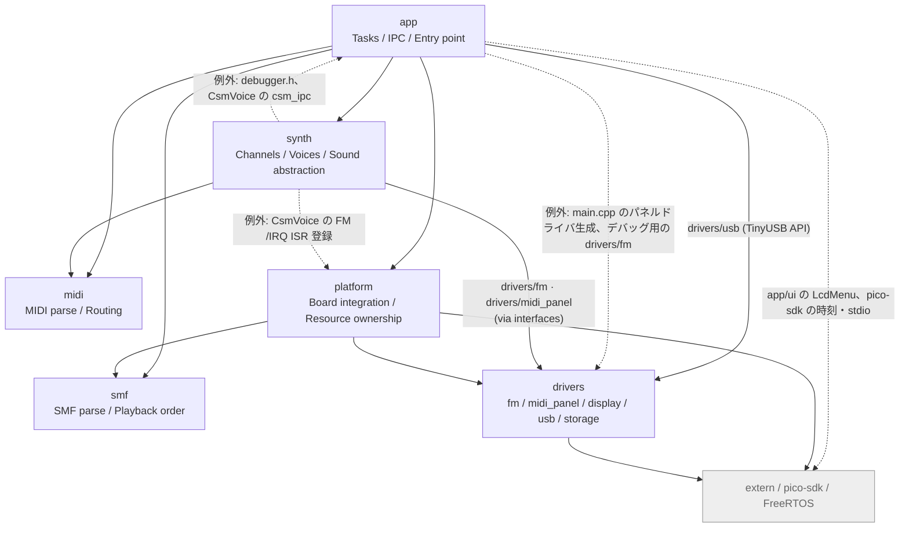

# ドメイン図

`src/` 配下の 6 パッケージ（`app` / `midi` / `smf` / `synth` / `platform` / `drivers`）をドメインとみなし、依存関係と各ドメインの主要クラスを示す。依存制約の定義と例外の一覧は [architecture.md](../architecture.md#4-依存関係) にあり、この図はその概観である。

## 全体ドメインチャート

`smf` のクラス図はない。構成は [design_smf_player.md](../../smf/design_smf_player.md) を参照。

## 各ドメインのクラス図

| ドキュメント | 内容 |
|---|---|
| [domain_app.md](domain_app.md) | タスク・IPC・デバッガ・設定・LCD メニュー |
| [domain_midi.md](domain_midi.md) | MidiMessage / MidiParser / MidiController / MidiSysEx |
| [domain_synth.md](domain_synth.md) | MidiProcessor / チャンネル / Voice / アロケータ |
| [domain_platform.md](domain_platform.md) | 初期化 / VolumeController / ISR / ディスプレイ |
| [domain_drivers.md](domain_drivers.md) | OpnBase 系 / opn_piolib / MIDI パネル / ディスプレイ / USB |
