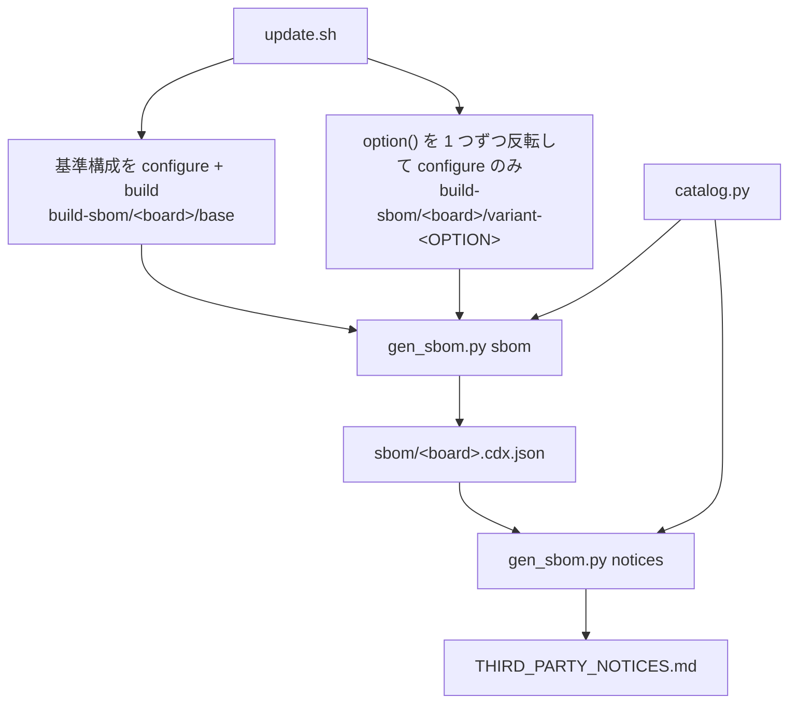

# SBOM とサードパーティライセンス表記

ファームウェアに含まれるサードパーティソフトウェアを CycloneDX 1.6 形式の SBOM として記録し、ライセンス表記（`THIRD_PARTY_NOTICES.md`）を同じ情報から生成する仕組みをまとめる。目的は 2 つで、ライセンス表記・遵守と、依存ライブラリを更新するときの影響判定である。

## 目次

1. [出力物](#1-出力物)
2. [生成の流れ](#2-生成の流れ)
3. [SBOM の内容](#3-sbom-の内容)
4. [運用](#4-運用)
5. [既知の制約](#5-既知の制約)

## 1. 出力物

| ファイル | 内容 |
|---|---|
| `sbom/pico2.cdx.json` | RP2350（`PICO_BOARD=pico2`）用ファームの SBOM |
| `sbom/pico.cdx.json` | RP2040（`PICO_BOARD=pico`）用ファームの SBOM |
| `THIRD_PARTY_NOTICES.md` | 両ボードでビルドに使われるコンポーネントの一覧とライセンス本文 |

いずれも生成物だが、リポジトリにコミットする。CI のアーティファクトは保持期間が短く、依存がいつどう変わったかを git の履歴で追えるようにするためである。CI は再生成した結果とコミット済みの内容を比べるだけで、自動コミットはしない。

比較できるように、出力は決定的にしている。タイムスタンプ・`serialNumber`・絶対パスは含めず、並び順も固定する。

SBOM は CMakeLists.txt の `option()` の既定値でビルドしたファームを対象とする。既定値と異なる構成で使われる項目は、条件付きとして同じ SBOM に記録する（[3.2](#32-スコープと構成条件)）。

## 2. 生成の流れ

スクリプトはすべて `scripts/sbom/` にある。

| ファイル | 役割 |
|---|---|
| `update.sh` | 入口。ビルド・反転構成の configure・生成・CI 用の比較 |
| `gen_sbom.py` | ビルドディレクトリを解析して SBOM と NOTICES を書く |
| `catalog.py` | コンポーネントの定義表（名前・場所・ライセンス・バージョンの取り方） |
| `outdated.py` | 上流に新しいリリースがあるか調べる |
| `impact.py` | 新しいバージョンの変更がこのファームに影響しうるか調べる |



`gen_sbom.py sbom` がビルドディレクトリから読む情報は次のとおり。

| 情報 | 取得元 | 反転構成でも取るか |
|---|---|---|
| コンパイルされるソース | `compile_commands.json` | 取る |
| インクルードディレクトリ | `compile_commands.json` の `-I` / `-isystem` / `-iquote` | 取る |
| pio プログラム | `ninja -t inputs <elf>` の `*.pio`。基準構成の ELF に `.program` ごとのシンボル `<name>_program` がないもの（リンクされていない pio）は除く | 取る（除外は基準構成の判定を使う） |
| リンカスクリプト | `ninja -t inputs <elf>` の `*.ld`、リンクコマンドの `-T` / `--script`、そこからの `INCLUDE` | 取る |
| リンクされたツールチェーンのライブラリ | リンカ map の "Archive member included" 節 | 取らない（リンク結果が必要なため） |
| pico-sdk・ツールチェーンの場所 | `CMakeCache.txt` | - |

反転構成は configure だけで済む情報に限っているので、ビルドしない。CI での追加時間はボードあたり configure 5 回分になる。

## 3. SBOM の内容

### 3.1 コンポーネントの定義

コンポーネントは `catalog.py` に手で定義する。ファイルの所属は `root` の最長一致で決めるので、pico-sdk の中の TinyUSB のように入れ子になったものは、SBOM でも親の `components` の中に入る。

| 区分 | コンポーネント |
|---|---|
| pico-sdk | pico-sdk、TinyUSB、CMSIS、printf（Marco Paland）、BTstack、cyw43-driver、lwIP、Mbed TLS |
| FreeRTOS | FreeRTOS-Kernel、RP2040 移植、Community-Supported-Ports と RP2350_ARM_NTZ 移植、Partner-Supported-Ports |
| SD カード | no-OS-FatFS-SD-SDIO-SPI-RPi-Pico、FatFs、SDIO ドライバ、SPI ドライバ |
| その他 extern | LcdMenu、NJU72343-library |
| ツールチェーン | newlib、libgcc、libstdc++ |

ライセンスの判断（`licenses` / `license_name`）は `catalog.py` で人が行う。`gen_sbom.py` はコンパイルされるファイル先頭の `SPDX-License-Identifier` を走査し、件数を `fmsynth:source-licenses` に記録するだけで、宣言値は変えない。宣言と食い違うファイルがあれば、ここに現れる。

`extern/submodules.lock` の submodule と pico-sdk の `.gitmodules` の submodule が `catalog.py` に登録されていないと、生成は失敗する。未登録の submodule のファイルは本体のコードと区別できず、SBOM から黙って漏れるためである。

### 3.2 スコープと構成条件

`scope` は既定構成のファームに含まれるかを表す。

| `scope` | 意味 |
|---|---|
| `required` | 既定構成でビルドに使われる |
| `optional` | 既定値以外の構成でだけ使われる |
| `excluded` | ソースツリーにあるが、どの構成でもビルドに使われない（BTstack など） |

コンポーネントの `fmsynth:condition` は、そのコンポーネントが使われる構成を表す。`always` は全構成、`BUILD_SD_CARD=ON` はそのオプションが ON のときだけを意味する。ツールチェーンのライブラリは既定構成のリンク結果だけで判定するので、`linked in the default configuration` になる。

`evidence.occurrences` には、ビルドに使われる項目を 1 件ずつ記録する。`location` はコンポーネントの root からの相対パス、`additionalContext` は種別と条件である。

```json
{ "location": "src/sd_driver/sd_card.c", "additionalContext": "source; only when BUILD_SD_CARD=ON" }
```

種別は `source`、`include-dir`、`pio`、`linker-script`、`archive` のいずれか。

### 3.3 記録の粒度

ヘッダはファイル単位ではなく、インクルードディレクトリ単位で記録する。ファイル単位にすると、自前のコードに `#include` を 1 行足しただけで SBOM が変わり、CI が再生成を求めることになる。インクルードディレクトリとソースの一覧は CMake の構成だけで決まるので、SBOM が変わるのは依存や構成を変えたときに限られる。

代わりに、影響判定（[4.4](#44-依存の更新確認と影響判定)）ではインクルードディレクトリ配下のヘッダをすべて「使われうる」とみなす。影響候補は実際より多めに出るが、見落としはしない。

### 3.4 独自プロパティ

CycloneDX の標準項目で表せない情報は、`fmsynth:` で始まる `properties` に置く。

| プロパティ | 付く場所 | 内容 |
|---|---|---|
| `fmsynth:board` / `fmsynth:platform` | metadata | `PICO_BOARD` / `PICO_PLATFORM` |
| `fmsynth:option:<NAME>` | metadata | 対象とした構成（`option()` の既定値） |
| `fmsynth:variants-analyzed` | metadata | 反転して解析したオプション |
| `fmsynth:root` | component | `repo:` / `sdk:` / `toolchain` からの場所 |
| `fmsynth:commit` | component | git リポジトリを持つコンポーネントのコミット |
| `fmsynth:git-component` / `fmsynth:git-path` | component | 自前の git を持たないコンポーネントが属するリポジトリと、その中のパス |
| `fmsynth:condition` | component | [3.2](#32-スコープと構成条件) 参照 |
| `fmsynth:source-licenses` | component | コンパイルされるファイルの SPDX 表記の件数 |
| `fmsynth:license-review` | component | ライセンス上の確認事項 |

git リポジトリを持つコンポーネントの `purl` は、コミットを含む `pkg:github/<owner>/<repo>@<commit>` にしている。`version` はタグ名・バージョンマクロ・`submodules.lock` の目安から取るため、表記の形式はコンポーネントによって異なる。

## 4. 運用

### 4.1 再生成が必要になる変更

- submodule や pico-sdk のバージョンを変えた
- `catalog.py` を変えた
- `option()` を追加・削除した、または既定値を変えた
- CMake でリンクするライブラリやソースを変え、サードパーティのソース・インクルードディレクトリが増減した

自前のコードの変更だけなら SBOM は変わらない。再生成が必要な変更を見落としても、CI の比較で失敗するので気づける。

### 4.2 生成と検査

```bash
scripts/sbom/update.sh                          # 両ボードをビルドして生成し、上書きする
scripts/sbom/update.sh --board pico2            # 指定ボードだけ
scripts/sbom/update.sh --build-dir build        # ビルド済みのディレクトリを使う（既定オプションであること）
scripts/sbom/update.sh --check --build-dir build   # 書き込まずにコミット済みの内容と比べる
```

作業ディレクトリは `build-sbom/` で、普段の `build/` には触らない。必要なものは通常のビルド環境と Python 3 の標準ライブラリだけである。所要時間は、手元で両ボードを生成して 40 秒程度（大半は基準構成のビルド）。

依存を更新するときは、`submodules.lock` と同じコミットに `sbom/` と `THIRD_PARTY_NOTICES.md` も含める（[architecture.md の外部ライブラリのバージョンを変える](architecture.md#外部ライブラリのバージョンを変える)）。

### 4.3 CI

[`.github/workflows/build.yml`](../.github/workflows/build.yml) の各ボードのジョブで、ファームのビルド後に `update.sh --check --build-dir build` を実行する。差分があればジョブが失敗し、差分が表示される。ファームのアーティファクトは、検査の前にアップロード済みである。

CI の pico-sdk のバージョン（`PICO_SDK_REF`）とツールチェーン（`ARM_GCC_RELEASE`）は、手元の環境と揃っている必要がある。揃っていないと、バージョン表記やリンクされたライブラリが変わり、比較に失敗する。

### 4.4 依存の更新確認と影響判定

上流のリリース状況は `outdated.py` で調べる。`git ls-remote` だけを使うので、リポジトリの状態は変わらない。

```bash
scripts/sbom/outdated.py          # ビルドに使われているコンポーネント
scripts/sbom/outdated.py --all    # ビルド対象外も含める
```

「管理元」列に親コンポーネントが出るもの（pico-sdk 同梱の TinyUSB など）は、親の更新に合わせて上がる。

新しいバージョンの変更がファームに影響しうるかは `impact.py` で調べる。

```bash
scripts/sbom/impact.py freertos-kernel V11.3.3
scripts/sbom/impact.py tinyusb 0.21.0 --list-unused
```

現在のコミットと指定したタグの差分ファイルを、SBOM の `evidence` と突き合わせて分類する。

| 分類 | 条件 |
|---|---|
| 影響候補 | コンパイルされるソース・pio・リンカスクリプトそのもの、インクルードディレクトリ配下のヘッダ、コンパイルされるソースと同じディレクトリのヘッダ |
| ビルド設定 | `CMakeLists.txt` / `*.cmake`（ビルド対象そのものが変わりうる） |
| submodule | 入れ子の submodule の更新（そのコンポーネントで改めて実行する） |
| 対象外 | 上記以外 |

最後に、影響候補とビルド設定に触れたコミットの一覧を出す。リリースノートを読む範囲を、ここに絞れる。上流の履歴は `.cache/sbom-repos/` に blob なしの bare clone を作って調べるので、submodule 自体には触らない。

## 5. 既知の制約

- ツールチェーンのライブラリ（newlib・libgcc・libstdc++）は、既定構成のリンク結果だけで判定している。構成による違いは記録しない。
- newlib のライセンス本文は NOTICES に載せず、`COPYING.NEWLIB` への参照だけにしている。newlib はファイルごとに異なる BSD 系ライセンスの集合で、リンクされたメンバーごとの表記は扱っていない。
- no-OS-FatFS の SDIO ドライバ（`src/sd_driver/SDIO`）は、上流 README によれば ZuluSCSI-firmware（GPL-3.0-or-later）由来である。一方、上流リポジトリ全体は Apache-2.0 と宣言されている。SD カードは SPI でのみ接続するので、SDIO ドライバはビルドから外している（[architecture.md の drivers/storage/](architecture.md#driversstorage)）。SBOM では `scope: excluded` とし、由来を `pedigree.ancestors` と `fmsynth:license-review` に記録している。SDIO 用の pio プログラム（`rp2040_sdio.pio`）は上流の CMake がヘッダを生成するが、どこからも使われずリンクされないので、SBOM でも除外される。
- SBOM が CycloneDX 1.6 のスキーマに適合するかは、自動では検証していない。
